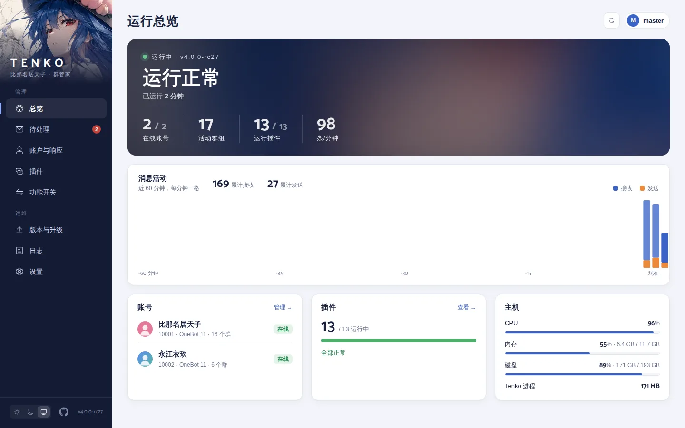
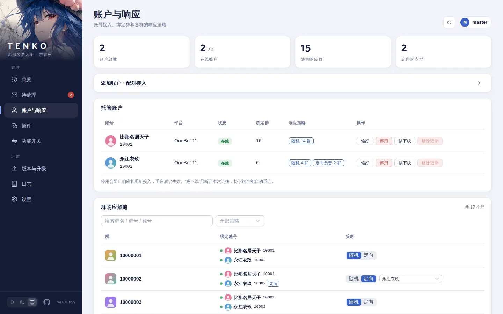
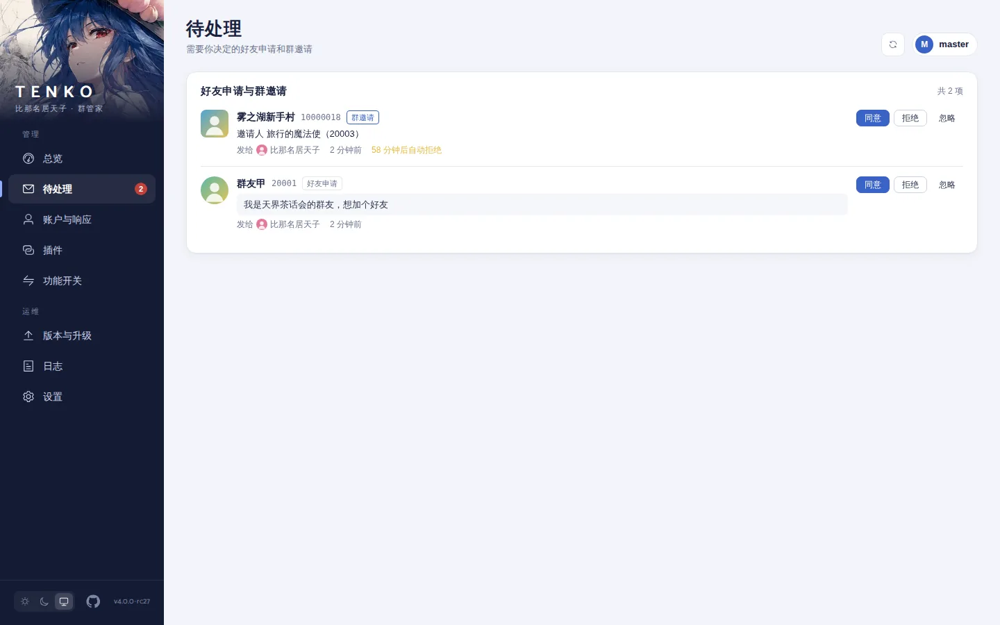
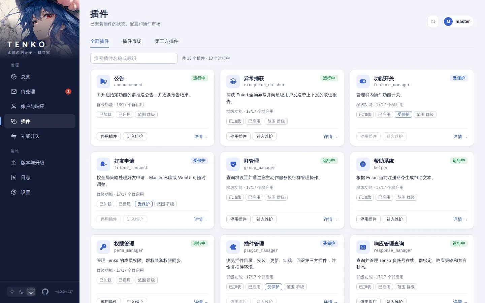
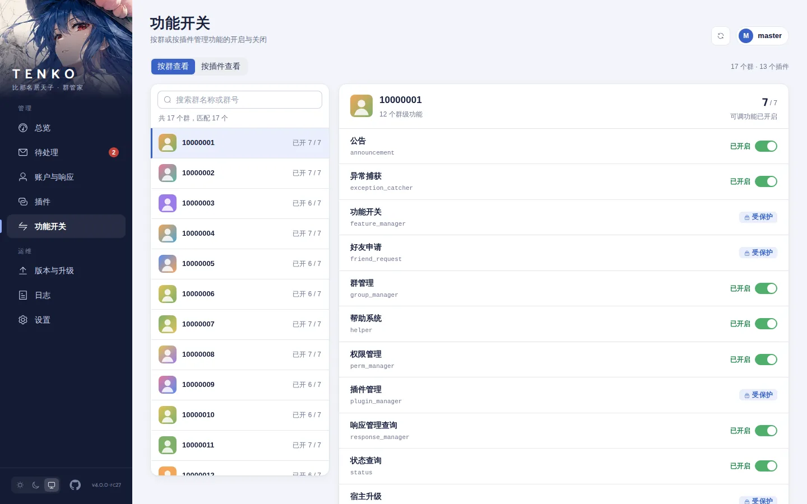
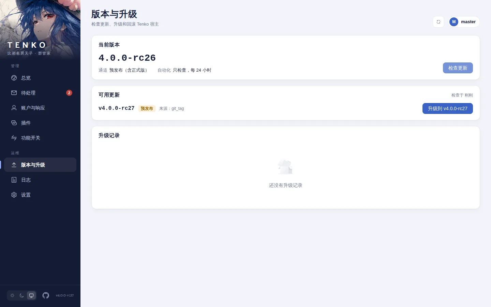
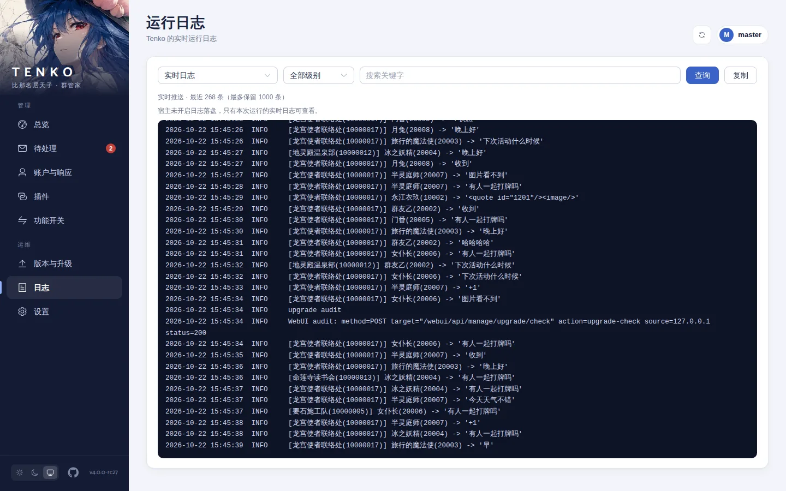
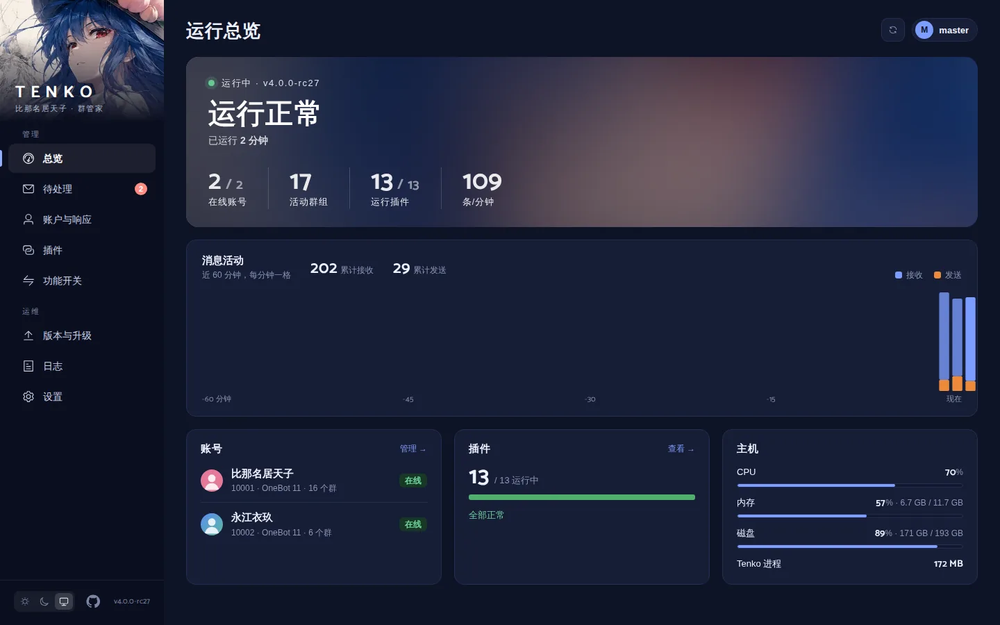
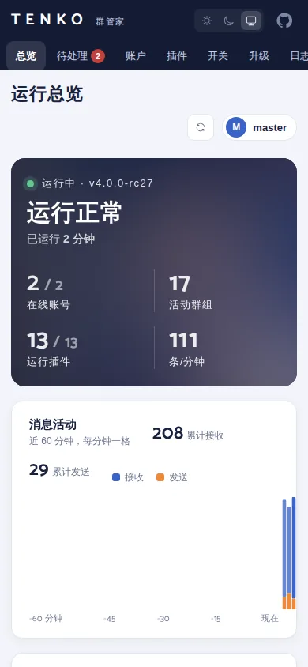

<p align="center">
  
</p>

<p align="center">
  
  
  
  
</p>

Tenko 是一个面向聊天群组的管理 bot，基于 Entari 与 Satori 协议抽象构建，
提供权限、群管理、多账号响应策略、功能开关、状态查询和宿主升级等能力。
Satori 的多协议设计使同一套插件逻辑可以运行在不同聊天平台上——当前通过
OneBot 11 协议接入 QQ（协议端推荐 NapCat，也可替换为任何兼容实现），
后续接入新平台只需增加对应的协议适配层。

<p align="center">
  
</p>

## WebUI 一览

内置的 Web 管理面板与 bot 共用监听端口，账号、插件、功能开关、升级和日志都能在浏览器里处理，
还能以 bot 的身份查看和回复群聊、私聊，或在命令沙盒里直接测试命令，
手机上也能用。以下截图来自演示环境，群号、账号和头像均为虚构。

<p align="center">
  
</p>

<table>
  <tr>
    <td width="50%"><br><sub><b>账户与响应</b>：多账号状态、各群随机或定向响应</sub></td>
    <td width="50%"><br><sub><b>待处理</b>：好友申请与群邀请，同意、拒绝或忽略</sub></td>
  </tr>
  <tr>
    <td><br><sub><b>插件</b>：启停、维护、插件市场与第三方插件</sub></td>
    <td><br><sub><b>功能开关</b>：按群或按插件开关功能</sub></td>
  </tr>
  <tr>
    <td><br><sub><b>版本与升级</b>：检查更新、升级与回滚</sub></td>
    <td><br><sub><b>日志</b>：实时日志、级别与关键字筛选</sub></td>
  </tr>
</table>

<p align="center">
  
  &nbsp;
  
</p>

面板的开启、登录、反向代理和各页面说明见 [WebUI 管理面板](docs/webui.md)。聊天页会把收发的消息
记录到数据库（默认保留 7 天），不需要时可在 [`[chat_log]`](docs/configuration.md#chat_log) 关闭。

## 缘起

Tenko 的名字取自东方 Project 中的比那名居天子——掌管大地的绯想之剑，
有顶天的天人。她不问因果、只按本心行事的气质，恰好是这只 bot
想要成为的样子：安静地悬于群聊之上，该出手时出手，无事时便隐入云端。

她的前身是 xiaomai-bot——诞生于 Graia Ariadne 框架时代的群管工具，
在多个聊天群里服役多年。2026 年夏天，旧骨架随协议与依赖一同老化，
于是推倒重来：以 Entari 为宿主、Satori 为协议抽象，沿用的是那套
沉淀下来的权限模型、群管逻辑与升级体系，舍去的是 Graia 时代的旧船票。
舟已换，航线未变——便是 Tenko。


## 功能

- **权限体系**——按成员和群两级管理权限，与平台管理角色自动同步；
- **群管理**——禁言、解禁、撤回、踢出、加精、加群审批等动作，带能力探测与失败回执；
- **多账号**——多个 bot 账号在同一宿主下共存，按群随机或定向响应，支持指定账号执行；
- **功能开关**——按群启用或停用某个插件，群管理员可自助调整；
- **状态与报告**——运行状态、消息统计、异常捕获，需要时以离线渲染的图片输出；
- **第三方插件**——从插件目录安装、更新、回滚，插件与宿主共用环境；
- **自我升级**——检查更新、下载校验、健康检查与回滚，升级不动配置和数据；
- **WebUI**——上面截图里的管理面板，好友申请和群邀请也能在这里处理。

命令统一使用 `/` 前缀，尖括号表示需要替换的参数，方括号表示可选。发送 `/帮助` 可查看当前
实际注册的命令。

| 插件 | 能力 | 常用命令 |
| --- | --- | --- |
| perm_manager | 成员权限、群权限、全局黑名单和 BOT 管理，同步平台管理角色 | /修改权限、/修改群权限、/权限列表、/全局黑、/BOT管理 |
| group_manager | 群设置、频率限制、加群邀请审批和群管理动作 | /群设置、/频率限制 [开启\|关闭]、/待审邀请、/同意邀请 <请求ID>、/拒绝邀请 <请求ID> [理由]、/禁言、/解禁、/撤回、/加精、/退群 <群号> <BOT账号> |
| response_manager | 多账号在线状态、群绑定、禁言状态和群响应策略 | /BOT列表、/在线BOT、/设定响应、/指定BOT |
| feature_manager | 按群启用或停用插件功能；控制平面插件不可由群管理员关闭 | /开启 <功能>、/关闭 <功能>、/清除插件数据 <插件ID> |
| friend_request | 按全局策略处理好友申请，其余留给 Master 在 WebUI 或私聊处理 | /好友申请 [关闭\|仅管理员\|所有人] |
| plugin_manager | Master 管理第三方插件 | /插件市场、/插件详情、/安装插件、/更新插件、/卸载插件、/回滚插件、/启用插件、/停用插件、/插件列表、/同步插件环境 |
| updater | 按配置通道检查、准备和回滚宿主版本，重启宿主 | /检查更新、/升级 [卸载不兼容插件]、/回滚、/重启 |
| status | 会话、进程资源、消息统计、在线账号和群路由状态 | /状态 |
| announcement | 向开启指定功能的群推送公告，逐群报告结果 | /公告 <功能名> <内容...> |
| helper | 根据当前注册的命令生成帮助 | /帮助、/帮助 <编号> |
| webui_account | Master 私聊管理面板账号、重置密码和强制下线 | /面板账号、/面板重置密码、/面板下线 |
| exception_catcher | 捕获全局异常，向超级用户发送带上下文的报告 | 无命令 |
| startup_notify | 启动就绪后播报启动耗时 | 无命令 |

群邀请只能由目标群的 BotAdmin/Master 审批；邀请人自身是 BotAdmin/Master 时自动同意，
其余邀请一小时内未处理会自动拒绝。好友申请策略保存在数据库中，可在 WebUI 设置页或由 Master
私聊 `/好友申请` 修改：`仅管理员`（默认）、`所有人` 或 `关闭`。

## 快速开始

需要 Python 3.11–3.13、[uv](https://docs.astral.sh/uv/)，以及一个 OneBot 11 协议端
（推荐 [NapCat](https://github.com/NapNeko/NapCatQQ)）。

```bash
git clone https://github.com/g1331/tenko.git
cd tenko
uv sync
cp config/tenko.toml.example config/tenko.toml
```

编辑 `config/tenko.toml`：至少把 `[basic].superusers` 改成你的 QQ 号，并给 `[onebot].access_token`
设一个随机值（完整字段见[配置参考](docs/configuration.md)）。然后在 NapCat 的 OneBot 11
反向 WebSocket 中填写下面的地址和同一个 token：

    ws://127.0.0.1:8080/onebot/v11/ws

启动：

```bash
uv run python -m tenko        # 生产部署可用 ./scripts/launcher.sh，见升级与部署
```

可选步骤：

- **图片输出**：`uv run python -m playwright install chromium`。浏览器不可用时状态和报告回退为文本。
- **WebUI**：把配置里的 `[webui].enabled` 改为 `true`，重启后访问 `http://127.0.0.1:8080/webui/`。
  用户名 `master`，密码由 Master 私聊 `/面板重置密码` 获取，或在部署目录执行
  `uv run python -m tenko webui-passwd`。

## 文档

| 文档 | 内容 |
| --- | --- |
| [配置参考](docs/configuration.md) | `config/tenko.toml` 的全部配置项和默认值 |
| [升级与部署](docs/upgrade.md) | 标准启动器、更新通道、`/升级` 流程、兼容性清单和目录结构 |
| [第三方插件](docs/plugins.md) | 编写插件、插件目录、安装与管理命令 |
| [WebUI 管理面板](docs/webui.md) | 开启与登录、反向代理、各页面功能、前端开发 |
| [开发指南](docs/development.md) | 开发环境、代码约定、测试和架构 |

参与开发前请先阅读 [AGENTS.md](AGENTS.md)。

## 许可

[GPL-3.0](LICENSE)
